# Enterprise Website — System Architecture, Audit & Evolution Blueprint

> **Purpose:** Authoritative architectural reference, empirical audit, and target evolution blueprint for human developers and future AI agents.
> **Baseline Verified:** 2026-11-14 | **Stack:** Django 5.2.19 LTS, DRF 3.18.2, django-allauth 65.22.0, Channels 4.3.2 / Daphne 4.2.3, Celery + Redis, Bootstrap 5.3.3 / Tailwind CDN / Minimal CSS | **Checks:** `manage.py check` (0 issues), `pytest` (381 passed).

---

## 1. Current Architecture Snapshot

### 1.1 Codebase Footprint (`diagnose.py arch-map`)
- **Files Scanned:** 496 | **Total Lines:** 46,076 | **Django Apps:** 18 internal apps (`enterprise_website/settings/apps.py`)
- **Active Plans (`plan_engine.py discover`):**
  - `.TODO/multi_theme_architecture_plan.md` (Complete)
  - `.TODO/coordinated_framework_upgrade_plan.md` (Complete)
  - `INTELLIGENT_TRACKER_INTEGRATION_PLAN.md`
  - `milestone_plan.md`

| Layer | Applications | Responsibility |
| :--- | :--- | :--- |
| **Project Core** | `enterprise_website` (`settings/`, `urls.py`, `asgi.py`, `celery.py`, `routing.py`) | Modular settings (`apps.py`, `base.py`, `integrations.py`, `security.py`, `storage.py`), ASGI/Channels + WSGI, Celery Beat |
| **Platform Infrastructure** | `plugin_registry`, `menu_management`, `theme_management`, `user_management`, `language_management`, `location_management`, `timezone_management`, `task_runner`, `rest_api`, `custom_tags` | Plugin autodiscovery, DB-backed navbar trees, 3-theme loader & `@layer` contract, `SiteUser` auth + Allauth, Rosetta i18n, Geo master data, TZ middleware, async Celery/WebSocket jobs, DRF endpoint, legacy template tags |
| **Business Domains** | `crm`, `erp` | Leads/pipeline/sequences/segments/analytics (`crm`), products/inventory/locations/invoices/ReportLab PDFs (`erp`) |
| **Edge AI & Media** | `intelligent_tracker_hub`, `video_gallery` | HMAC-secured edge AI webhooks, camera telemetry, MJPEG proxy, gate access/whitelist sync, zero-copy evidence gallery |
| **Showcase / Standalone** | `home`, `polls`, `todo`, `webprogram` | Static marketing pages (`home`), voting polls, HTMX-enabled todo list, Brython client-side Python demo |

### 1.2 High-Level Dependency Topology

```mermaid
flowchart TD
    subgraph Client["Presentation & Theme Shell"]
        Templates["Theme Shells (bootstrap5 / tailwind / minimal)"]
        Loader["theme_management.loaders.ThemeTemplateLoader"]
        Menus["menu_management.context_processors.dynamic_menu"]
    end

    subgraph Platform["Platform Backbone"]
        Plugins["plugin_registry.AppPlugin"]
        Auth["user_management.SiteUser + django-allauth"]
        Geo["location_management (Countries/States/Cities/Location)"]
        TZ["timezone_management.TimezoneMiddleware"]
        I18N["language_management + django-rosetta"]
        Tasks["task_runner (Celery + Channels WebSockets)"]
        API["rest_api (/rest_api/ DRF)"]
    end

    subgraph Domains["Business & Edge Domains"]
        Home["home (Static Marketing Views)"]
        CRM["crm (Leads, Contacts, Sequences)"]
        ERP["erp (Products, Stock, Invoices)"]
        Hub["intelligent_tracker_hub (/security/, /api/v1/)"]
        Gallery["video_gallery (/media/)"]
        Showcases["todo, polls, webprogram"]
    end

    Plugins --> Menus
    Plugins --> Loader
    Plugins --> Tasks
    Templates --> Menus
    Templates --> Loader

    Auth --> Geo
    Auth --> TZ
    CRM --> Geo
    CRM --> Tasks
    ERP --> Tasks
    Hub --> Geo
    Hub --> Gallery
    Hub --> CRM
    Hub --> Auth
    Showcases --> Plugins
    Home --> Plugins
    I18N --> Tasks
```

### 1.3 Verified Cross-App Coupling Matrix

| App | Depends On | Depended Upon By | Notes |
| :--- | :--- | :--- | :--- |
| `plugin_registry` | None | `menu_management`, `theme_management`, `task_runner`, all `plugin.py` apps | Pure in-memory registry; autodiscovers `<app>.plugin` on `ready()` |
| `menu_management` | `plugin_registry` | Global templates (`dynamic_menu` context processor) | DB `Menu` + `MenuItem` synced idempotently via `sync_menus` |
| `theme_management` | `plugin_registry` | Global templates (`ThemeMiddleware`, `ThemeTemplateLoader`) | Precedence: `?theme=` -> session -> cookie -> `SITE_THEME` |
| `location_management` | `custom_tags.utils` | `user_management`, `crm`, `intelligent_tracker_hub` | Authoritative `Location` site model for physical security & CRM |
| `timezone_management` | None | `user_management`, `todo` | Session `django_timezone` middleware; no `app_name` in `urls.py` |
| `user_management` | `location_management`, `timezone_management`, `custom_tags.utils` | `task_runner`, `crm`, `erp`, `intelligent_tracker_hub`, `rest_api` | `AUTH_USER_MODEL = 'user_management.SiteUser'` |
| `language_management` | `plugin_registry`, `task_runner` (task ref), root `utils` | Rosetta, global templates | Services: `catalog_engine.py`, `translator.py` |
| `task_runner` | `plugin_registry`, `user_management`, Celery, Channels | `language_management`, `crm`, `erp` | Tracks `TaskJob` and broadcasts WebSocket progress |
| `crm` | `plugin_registry`, `task_runner`, `location_management`, `user_management` | `intelligent_tracker_hub` | `Contact` stores physical access & face embedding fields |
| `erp` | `plugin_registry`, `task_runner`, `user_management`, ReportLab | Standalone (`ERPProcurement/Warehouse/Accounting` are stubs) | Atomic `StockMovement`, `Invoice` + PDF |
| `intelligent_tracker_hub` | `plugin_registry`, `location_management`, `video_gallery`, `crm`, `user_management` | Edge AI Vision Microservice (`intelligent-tracker`) | Most coupled app; maintains separate `/api/v1/` HMAC API |
| `video_gallery` | `plugin_registry` | `intelligent_tracker_hub` | Referenced by `SecurityEvent.video_evidence` |
| `home` | `plugin_registry`, `theme_management` | `menu_management` | Zero DB models; static templates only |
| `polls`, `todo`, `webprogram` | `plugin_registry`; `todo` reads `django_timezone`; `custom_tags` reads `polls.Choice` | `theme_management` (`todo` verifies `plugin_templates`) | Isolated showcase apps |

---

## 2. Empirical Audit: Bugs, Security Risks, Debt & Modularity Hotspots

### 2.1 Functional Bugs, Security Risks & Dead Code

| Severity | Area / File | Verified Finding | Recommended Remediation |
| :--- | :--- | :--- | :--- |
| **HIGH (Privacy / Security)** | `enterprise_website/settings/integrations.py#L73-L75` & `rest_api/urls.py#L37-L43` | `DEFAULT_PERMISSION_CLASSES` uses `DjangoModelPermissionsOrAnonReadOnly`, and `UserViewSet` exposes `SiteUser` fields (`email`, `phone_number`, `birthdate`, `is_staff`, `is_superuser`) on `/rest_api/users/` to anonymous `GET` requests. | Restrict `UserViewSet` to `IsAdminUser` (or `IsAuthenticated` with self-only queryset) and move serializers/viewsets out of `urls.py` into `views.py`/`serializers.py`. |
| **HIGH (Secret Hygiene)** | `templates/partials/scripts.html#L31`, `enterprise_website/settings/base.py#L24-L34`, `enterprise_website/settings/integrations.py#L111-L114`, `docker-compose.yml#L15,L22` | Commented Google Maps API key string in `scripts.html`; insecure default `SECRET_KEY` and `INTELLIGENT_TRACKER_SECRET_KEY` fallbacks in settings and Compose; legacy `keys.json` fallback. | Remove literal API key comment from `scripts.html`; enforce explicit env-var failure in production (`DEBUG=False`); deprecate `keys.json` per `.agents/rules/security_and_standards.md`. |
| **MEDIUM (Broken Flow)** | `home/views.py#L57-L66` | `ContactView.post` validates `name`, `email`, `message` and flashes `messages.success`, **but drops the payload** without saving to DB, sending mail, or creating a CRM lead. | Persist contact submissions (or route directly into `crm.Lead` / `crm.Contact` + async notification task via `task_runner`). |
| **MEDIUM (Dead / Broken View)** | `user_management/views.py#L193-L205` | `upload_pic` is unrouted dead code with a broken body (`m = request; m.model_pic = form.cleaned_data['image']; m.save()`). | Remove `upload_pic` and obsolete `user_management/upload_image_form.html` (or replace with a proper `SiteUser` avatar update view). |
| **MEDIUM (CMS / Menu Limitation)** | `menu_management/context_processors.py#L52-L59`, `templates/themes/bootstrap5/partials/header.html#L20-L34`, `templates/themes/tailwind/partials/header.html#L19-L42` | `dynamic_menu` queries the DB on every request without caching; theme headers render at most **2 levels** (3rd-level sub-pages are dropped); dropdown parent `<a>` uses `data-bs-toggle="dropdown"` so parent tabs cannot link to their own landing page; `` cannot translate admin-created dynamic page titles. | Cache menu trees per user role/language (invalidate on `MenuItem` save/delete); support recursive/3-level or split-caret dropdowns; back DB titles with model i18n or Wagtail page localization. |
| **LOW (i18n / Dead Code)** | `webprogram/views.py#L13,L20-L21` | Hardcoded Japanese string `"Brythonを使ったやつ"` without `gettext`; dead `index2` view. | Wrap title in `gettext_lazy` and remove `index2`. |
| **LOW (Routing & Coupling)** | `timezone_management/urls.py`, `custom_tags/templatetags/present.py#L25`, `language_management/models.py`, `language_management/views.py#L5,L14` | `timezone_management/urls.py` omits `app_name`; `present.py` hardcodes `model.choice_set.all()` (coupling `custom_tags` to `polls`); `LayoutLanguages` model is unused and unregistered in admin; `language_management/views.py` imports unused root `utils.get_referer_view`. | Add `app_name = 'timezone_management'` (updating callers), move `show_results` into `polls/templatetags/`, and prune dead `LayoutLanguages` / unused imports. |
| **LOW (Packaging / Static Debt)** | `polls/` (`setup.py`, `MANIFEST.in`, `README.rst`), `templates/base.html`, `static/js/vendor/` | Legacy tutorial packaging files remain in `polls/`; root `templates/base.html` still references legacy scripts alongside `templates/themes/*`; `diagnose.py scan` flagged 6 quarantined JS smells inside `static/js/vendor/` (`chart.umd.min.js`, `htmx.min.js`, `jquery-2.2.4.min.js`). | Exclude/ignore third-party minified bundles in `static/js/vendor/` during scans (`dismiss-defect` or scan path filtering), archive `polls` packaging remnants, and retire unused legacy `templates/base.html` once verified unreferenced. |

### 2.2 Modularity Budget Hotspots (`diagnose.py arch-map --full`)
- **Files >= 500L (HARD):** `intelligent_tracker_hub/templates/intelligent_tracker_hub/dashboard.html` (630L), `static/css/main.css` (4025L), `static/js/slick.js` (2892L), `static/scss/bootstrap/_variables.scss` (894L), `static/scss/theme/_reset.scss` (748L), `static/css/linearicons.css` (536L).
- **Files 350-499L (WARN):** `intelligent_tracker_hub/models.py` (421L), `language_management/services/translator.py` (419L), `erp/templates/erp/dashboard.html` (410L), `home/templates/home/index.html` (396L), `task_runner/templates/task_runner/job_list.html` (357L).
- **Classes > 12 Methods:** `language_management/management/commands/auto_translate.py::Command` (15 methods, 259L).
- **Functions > 40L (Top Offenders of 39 total):**
  - `erp/pdf.py::generate_invoice_pdf` (248L)
  - `intelligent_tracker_hub/api/access_control.py::post` (195L)
  - `crm/tasks.py::process_email_sequences` (137L)
  - `intelligent_tracker_hub/api/video_evidence.py::post` (135L), `security_events.py::post` (131L), `video_streaming.py::get` (129L)
  - `crm/utils.py::get_crm_analytics_data` (116L)
  - `language_management/services/catalog_engine.py::process_catalog` (115L)
  - `menu_management/sync.py::sync_plugin_menus` (111L)
- **Unused Imports:** Reported across 54 files (including `enterprise_website/urls.py`, `home/views.py`, `intelligent_tracker_hub/views.py`, `language_management/views.py`).

---

## 3. Target Objective for Future Agents

### 3.1 Core Problem to Solve
Today, `enterprise_website` is a **well-engineered infrastructure shell hosting disconnected vertical apps**:
1. **No Dynamic Content / Blog Engine:** `home` renders static HTML templates. Admins cannot create a new navigation tab with nested sub-pages, edit landing-page blocks, or publish multilingual blog articles from the admin.
2. **Siloed "Stack of Tools" UX:** Public pages (`home`), business suites (`crm`, `erp`), security (`intelligent_tracker_hub`), media (`video_gallery`), and utilities (`polls`, `todo`, `webprogram`) operate in separate silos with inconsistent entry points, no shared search/activity stream, and no cross-app embeddable blocks.
3. **Under-Leveraged Plugin Contract:** `plugin_registry.AppPlugin` currently registers only `menu_items`, `tasks`, `settings_defaults`, and `plugin_templates`. It does not expose **embeddable page widgets/blocks**, **API routers**, **dashboard KPI cards**, or **site-search providers**, nor is there a clean adapter pattern for installing third-party Django ecosystem packages.

### 3.2 North-Star Architectural Principles
Future agents evolving this platform should follow these invariants:
1. **Single Cohesive Experience (Zone Separation):** Separate the UX cleanly into **Public Portal** (CMS pages, blog, public catalog, contact/lead capture, polls, media), **Customer/Member Portal** (profile, bookings/tickets/invoices), **Staff Operations Workspace** (`crm`, `erp`, `intelligent_tracker_hub`, `task_runner`, Admin/CMS), and **Labs/Sandbox** (`webprogram`, `todo` unless promoted).
2. **Ecosystem-First, Adapter-Wrapped:** Prefer battle-tested Django 5.2 packages wrapped behind thin project adapters (`AppPlugin` + `ThemeTemplateLoader` + `theme-adapter.css`) rather than building bespoke rich-text editors, page trees, or OpenAPI generators from scratch.
3. **Content-to-Domain Pipelines:** Every public interaction should feed a real domain model (e.g., Contact/CTA forms -> `crm.Lead`; Product showcase -> `erp.Product`; Blog embeds -> `video_gallery.VideoItem` and `polls.Question`).
4. **Multi-Theme & i18n Parity:** Any CMS/Blog or ecosystem UI added must extend `base.html`, use `@layer` / `theme-adapter.css` semantic classes, avoid `!important` and inline styles, and support `en/es/pt/fr/it/ja`.
5. **Modularity Discipline:** Keep new Python modules <= 350L and functions <= 40L; decompose existing WARN/HARD files before adding features to them.

---

## 4. Django Ecosystem & Marketplace Evaluation

The table below evaluates established Django 5.2-compatible packages (PyPI / Django Packages ecosystem) against this project's existing `AppPlugin`, `menu_management`, `theme_management`, and `rosetta` architecture.

| Capability Needed | Ecosystem Contenders | Fit with `enterprise_website` | Pros & Trade-offs | Integration Path via Project Architecture |
| :--- | :--- | :--- | :--- | :--- |
| **Hierarchical Pages & Blog Builder** | **Wagtail** (`wagtail` + `puput` or custom `BlogPage`) | **High (Recommended)** | Native Django ORM `Page` tree, `StreamField` block composer, drafts/revisions/previews, scheduled publishing, built-in image/document library. Runs its own `/cms/` editorial UI alongside `/admin/`. | Mount Wagtail under `/cms/` and fallback catch-all route; build a `cms_bridge` `AppPlugin` that syncs top-level `show_in_menus` Wagtail pages into `menu_management` and renders `StreamField` blocks with `bootstrap5`/`tailwind`/`minimal` partial templates. |
| **Inline WYSIWYG Page & Blog Builder** | **django CMS** (`django-cms` + `djangocms-blog` + `djangocms-frontend`) | **Medium** | Best-in-class *frontend inline* drag-and-drop editing and Bootstrap 5 frontend plugins; multilingual via `django-parler`. However, deeper middleware/URL coupling with existing 18 apps and heavier upgrade lock-in. | Wrap `apphooks` around existing `home`/`crm`/`erp` namespaces; requires aligning `ThemeMiddleware` and `LocaleMiddleware` carefully with `cms.middleware`. |
| **Minimalist Custom CMS / Page Tree** | **feincms3** (`django-content-editor` + `django-tree-queries`) or `django-treebeard` + `django-ckeditor-5` | **High (Lightweight)** | Zero separate CMS admin; lives 100% inside Django Admin; extreme control over models and `theme-adapter.css` templates. Trade-off: lacks Wagtail's live preview, workflow states, and media library out of the box. | Create a `cms` app registering `Page` + `BlogPost` plugins, using `django-content-editor` regions rendered through `ThemeTemplateLoader`. |
| **Modern Admin & Staff Workspace UI** | **django-unfold** (Tailwind) or **django-jazzmin** (BS5/AdminLTE) | **High** | `django-unfold` transforms stock Django Admin into a modern SaaS backoffice with grouped sidebars, KPI cards, and dark mode; `django-jazzmin` stays Bootstrap-aligned. | Place before `django.contrib.admin` in `INSTALLED_APPS`; drive Unfold sidebar sections directly from `plugin_registry.registry.get_all_plugins()` grouped by `category`. |
| **Model-Level Content Translation** | **django-modeltranslation** or **django-parler** (or `wagtail-localize`) | **High (Required for Dynamic Pages)** | `.po`/Rosetta only translates static template strings, **not** admin-created page titles, tabs, or blog posts. `modeltranslation` adds per-language columns transparently; `parler` uses translation tables; `wagtail-localize` integrates with PO/DeepL. | Pair with `language_management` so admin-created tabs/pages/posts automatically translate across `LANGUAGES` (`en, es, pt, fr, it, ja`). |
| **Unified API & OpenAPI Docs** | **drf-spectacular** (on existing DRF) or **django-ninja** | **High** | `drf-spectacular` auto-generates OpenAPI 3 / Swagger / Redoc from existing DRF 3.18.2 without rewriting endpoints. | Add an `api_router` hook to `AppPlugin` so `crm`, `erp`, `intelligent_tracker_hub`, `polls`, and `user_management` mount cleanly under `/api/v1/` with unified docs. |
| **Query Filtering & Bulk Admin Ops** | **django-filter**, **django-import-export** | **High** | Eliminates manual `request.GET` filtering boilerplate in `crm`/`erp`/`video_gallery` and enables CSV/XLSX import/export in admin. | Wire `FilterSet` classes into list views/API viewsets and `ImportExportModelAdmin` into `erp`/`crm`/`location_management`. |
| **HTMX Ergonomics & Partial Rendering** | **django-htmx**, **django-template-partials** | **High** | `htmx` 1.9.12 is already loaded in templates (`todo` uses `HX-Request`), but `django-htmx` middleware (`request.htmx`) and named inline partials make partial updates clean across all apps. | Add `django-htmx` middleware to support zero-reload page blocks, inline polls, and live CRM/ERP tables across all 3 themes. |
| **Media & Cloud Storage** | **django-filer** / **django-storages** | **Medium-High** | `django-filer` adds folder-organized media management; `django-storages` swaps local `media/` for S3/GCS/Azure in production. | Share media vault between Blog/Pages, `erp.Product` images, and `video_gallery` thumbnails. |

---

## 5. Three-Tier Target Architecture Options

1. **Tier 1 — Pragmatic Custom Page & Blog App (`pages` + `django-treebeard` + `django-unfold`)**
   - Build a focused `pages` Django app inside the existing admin (`django-unfold` styled) with hierarchical `Page` (treebeard), `BlogPost`, `Category`/`Tag`, and JSON/inline content blocks (`django-content-editor`).
   - *Best when:* You want 100% of management in a single Django Admin, minimal external framework conventions, and fast incremental shipping.
2. **Tier 2 — Hybrid Ecosystem Platform (`Wagtail` + `AppPlugin v2` + `django-unfold`) [Recommended]**
   - Use **Wagtail** as the hierarchical Page & Blog engine (`StreamField` blocks + draft/publish/schedule + previews + `show_in_menus` sync into `menu_management`), while keeping `crm`, `erp`, `intelligent_tracker_hub`, and `task_runner` in a `django-unfold`-themed Staff Workspace.
   - Extend `AppPlugin` (`plugin_registry/base.py`) with **Page Block Providers** (so any app—`polls`, `video_gallery`, `erp`, `crm`—can expose reusable `StreamField`/widget blocks that editors drop onto any page or blog post!) and **API Router hooks**.
   - *Best when:* You want a state-of-the-art editorial/blog experience AND true cross-app composition without reinventing a CMS.
3. **Tier 3 — Visual Inline Builder + Headless Composable API (`django CMS` OR Headless `Wagtail` + `drf-spectacular`/`django-ninja`)**
   - Either adopt `django CMS` (`djangocms-frontend` BS5 + `djangocms-blog`) for live on-page drag-and-drop editing, OR decouple content delivery via headless APIs + server-driven HTMX/Alpine block registry.
   - *Best when:* Non-technical editors strictly demand live on-page WYSIWYG editing or multi-channel headless mobile/web consumers.

---

## 6. Cross-Tool Synergy & Separation-of-Usages Matrix

To eliminate the *"stack of disconnected tools"* feel, every existing app is evaluated below for **where it belongs**, **what it should reuse from / feed into other apps**, and **whether to merge, embed, or isolate it**.

| App / Tool | Primary Audience & Zone | Keep Together or Separate? | Concrete Reuse & Cross-Tool Integration | Architectural Recommendation |
| :--- | :--- | :--- | :--- | :--- |
| **`home`** | Public Portal | **Merge into CMS / Page Engine** | Currently static views; `ContactView` drops data; `products.html` is hardcoded. Convert Home, About, Services into CMS-managed root pages; wire Contact form directly to **`crm.Lead` + `crm.InteractionLog`**; render Products dynamically from **`erp.Product`** (`is_public=True`). | **Upgrade / Absorb:** Replace static pages with dynamic CMS `Page` models while preserving legacy URL redirects (`/about.html`, etc.). |
| **`menu_management` & `plugin_registry`** | Platform Backbone | **Central Unifier (Keep & Upgrade)** | Currently syncs static `AppPlugin.menu_items` only (2-level header). Extend `AppPlugin` with `blocks/widgets`, `dashboard_widgets`, `search_provider`, and `api_urlpatterns`. Let `menu_management` merge **Plugin Tabs** + **CMS Page Tree** + **Footer Menu**. | **Upgrade to v2 Backbone:** Add caching, 3-level/mega-menu rendering, clickable parent pages, and CMS page FK links. |
| **`theme_management`** | Platform Presentation | **Keep Unified (Enforce Everywhere)** | Already enforces `bootstrap5` / `tailwind` / `minimal` via `@layer`. Ensure new CMS/Blog blocks and `django-htmx` partials render cleanly under `theme-adapter.css`, and retire legacy `templates/base.html` drift. | **Keep & Enforce:** Make every CMS `StreamField`/block template theme-aware via `ThemeTemplateLoader`. |
| **`video_gallery`** | Cross-Cutting Media Asset Hub | **Reuse Everywhere (Public + Security)** | Currently only linked by `intelligent_tracker_hub.SecurityEvent`. Keep public curated galleries (`is_public=True`) separate from private security evidence (`requires_staff=True`), and expose `VideoItem` as an **embeddable CMS/Blog block** and **`erp.Product` demo media**. | **Unify as Media Provider:** Separate public showcase vs private security vault via permissions, and register a CMS video block. |
| **`polls`** | Public & Member Engagement | **Embed, Don't Silo** | Instead of hiding polls only under `/polls/`, expose an `AppPlugin` **Poll Embed Block** so editors can drop live polls inside Blog posts, Product pages, or Community announcements, and optionally store poll respondent emails/feedback as **`crm.InteractionLog`**. | **Keep & Embed:** Add CMS widget + clean `custom_tags/present.py` coupling by moving tag into `polls`. |
| **`crm`** | Staff Backoffice + Public Lead Funnel | **Separate Staff UI; Expose Public Capture Hooks** | `crm.Contact` already links to `location_management` and `intelligent_tracker_hub` (visitor clearance). Add a **Lead Capture Service** reused by `home` Contact form, Newsletter signup, Blog CTA blocks, and `erp` Quote Requests. | **Keep Backoffice Separate; Share Intake API:** Expose reusable `LeadFormBlock` for CMS pages and link `Contact` <-> `SiteUser` (optional portal link). |
| **`erp`** | Staff Backoffice + Public Product Catalog | **Separate Inventory/Invoicing; Expose Catalog** | `erp.Product` has prices, SKU, descriptions, categories—while `home/products.html` is static! Add `is_published` / `public_summary` / `featured_image` on `Product` (or CMS `ProductShowcaseBlock`) so public Products pages stay synced with real ERP inventory. Link `Invoice.customer` optionally to **`crm.Company` / `crm.Contact`** instead of plain text! | **Integrate with CRM & Public Pages:** Link `erp.Invoice` -> `crm.Company/Contact`; expose read-only `ProductCatalogBlock` to public pages; remove or implement stub plugins cleanly. |
| **`intelligent_tracker_hub`** | Staff Security Ops + Edge API | **Strictly Isolate Security Zone** | Already well-integrated with `location_management`, `crm.Contact`, `video_gallery`, and `user_management`. Keep `/security/` and `/api/v1/` strictly gated (`is_staff` + HMAC) and **not** mixed into public nav (`requires_staff=True` in `AppPlugin`). | **Keep Isolated & Modularize:** Decompose `dashboard.html` (630L) and `api/*.py` functions > 40L; keep strict boundary from public CMS. |
| **`todo`** | Staff / Cross-App Action Center | **Promote to Cross-App `ActionItem` (`requires_staff=True` / User Portal)** | Currently a standalone 1-model CRUD demo (`title`, `text`, `created_at`) with no `user` FK. Add `owner` (`SiteUser`), `status`, `due_at`, and generic `content_type`/`object_id` target so it acts as a **Cross-App ActionItem / Follow-up Drawer** for `crm.Lead`, `erp.Invoice`, and `SecurityEvent` (while keeping its multi-theme `plugin_templates` test role). | **Promote & Integrate:** Attach owner + `GenericForeignKey`, gate behind auth/staff workspace, and auto-create follow-up tasks from Lead Intake. |
| **`webprogram`** | Developer Sandbox / Labs | **Separate into Optional "Labs" Plugin** | Brython client-side Python demo has no coupling to enterprise workflows (`crm`, `erp`, `cms`). | **Isolate / Feature-Flag:** Keep behind an optional `ENABLE_LABS_PLUGINS` toggle / staff-only Labs menu rather than top-level public enterprise nav. |
| **`task_runner`** | Staff Ops Infrastructure | **Keep Shared Engine; Hide from Public** | Already used by `language_management`, `crm`, and `erp`. Keep `/tasks/` staff-only (`requires_staff=True`) and surface job-progress toast/drawer widgets inside `crm` broadcasts, `erp` bulk invoicing, and `language_management` auto-translate. | **Keep as Shared Ops Backbone:** Expose reusable HTMX/WebSocket job-status partial for any app triggering async work. |
| **`language_management` + `timezone_management` + `location_management`** | Platform Utilities | **Keep Shared Core; Merge UX Controls** | `location_management` is already the shared geo master. `language_management` (`LayoutLanguages` dead model) and `timezone_management` (missing `app_name`) should combine into a clean **Locale & Preferences** service (auto-syncing user `SiteUser.timezone` and `preferred_language` across sessions). | **Consolidate Preferences:** Fix `app_name`, remove `LayoutLanguages` dead model, add model-level i18n via `wagtail-localize` for dynamic CMS/Blog content. |
| **`rest_api`** | API Gateway | **Merge with `/api/v1/` & Secure** | Currently only exposes `SiteUser` (anonymously readable!). Unify `/rest_api/` and `/api/v1/` under a single versioned `/api/v1/` namespace with `drf-spectacular` Swagger docs and per-plugin router registration (`AppPlugin.api_urlpatterns`). | **Unify & Harden:** Fix anonymous `UserViewSet` exposure immediately; add `drf-spectacular` + plugin API auto-mounting. |

---

## 7. Locked Architectural Decisions (`/grill-me` — 2026-11-14)

All 6 design-tree branches have been resolved with the user and form the binding contract for future agents:

1. **CMS & Blog Engine — Wagtail Hybrid (`wagtail` + `StreamField` + Live Preview + Userbar + `cms_bridge`)**
   - Mount Wagtail editorial UI at `/cms/` (with frontend Userbar + Side-by-Side Live Preview + Draftail WYSIWYG) and serve dynamic hierarchical `Page` trees + `BlogIndexPage` / `BlogPage` via theme-aware templates extending `base.html` and `theme-adapter.css`.
2. **Backoffice & Staff Workspace — `django-unfold` (`/admin/`) + Wagtail (`/cms/`) + Frontend Ops Dashboards**
   - Skin `/admin/` with `django-unfold` (modern Tailwind UI) with cross-links to `/cms/` (editorial content), `/rosetta/` (static PO translations), and frontend operational dashboards (`/crm/`, `/erp/`, `/security/`, `/tasks/`).
3. **Navigation Hierarchy & Dynamic i18n — Unified `menu_management` + `wagtail-localize`**
   - Sync Wagtail `show_in_menus` pages idempotently into `menu_management` alongside `AppPlugin.menu_items` and custom links (single unified navbar).
   - Add per-role/locale caching (invalidated on `MenuItem`/Wagtail publish signals), support **clickable parent tabs** + **2-level header dropdowns** + **contextual section sidebar for 3rd-level sub-pages**, and translate dynamic CMS/Blog content across all 6 locales via `wagtail-localize` (integrating with `.po` / DeepL / Google Translate).
4. **Zone Separation & Tool Lifecycle — Public Portal vs. Staff Workspace vs. Labs**
   - **Public Portal:** CMS Pages, Blog, Public `erp` Product Showcase, Public `video_gallery`, Embedded `polls`, Contact/Lead Capture.
   - **Staff Workspace (`requires_staff=True`):** `crm`, `erp`, `intelligent_tracker_hub`, `task_runner`, `/cms/`, `/admin/`, and promoted **`todo` (`ActionItem`)** linked to `SiteUser` + generic target entities (`crm.Lead`, `erp.Invoice`, `SecurityEvent`).
   - **Labs (`ENABLE_LABS_PLUGINS`):** `webprogram` (Brython) isolated behind feature flag / Labs menu.
5. **Cross-App Data & Block Reuse (`AppPlugin v2`)**
   - **Lead Intake Pipeline:** `home` Contact & CMS CTA blocks create `crm.Lead` + auto-create a staff follow-up `ActionItem` (`todo`).
   - **Public Catalog & CRM Invoicing:** Published `erp.Product` records render on public Product pages & CMS blocks; `erp.Invoice` links optionally to `crm.Company`/`crm.Contact`.
   - **Composable CMS Blocks:** `AppPlugin v2` allows apps (`video_gallery`, `polls`, `erp`, `crm`) to expose Wagtail `StreamField` blocks (gating private `SecurityEvent` video evidence strictly to staff).
   - **Locale & Preferences Consolidation:** Fix `timezone_management` `app_name`, remove dead `LayoutLanguages`, and sync user preferences with `SiteUser`.
6. **Security Hardening, API Unification & In-App Plugin Marketplace**
   - **Hardening:** Lock down `/rest_api/users/` (`IsAdminUser` / authenticated self-only), strip `templates/partials/scripts.html#L31` literal key comment, enforce strict production env-var checks (`DEBUG=False`), and resolve dead views (`user_management.views.upload_pic`, `webprogram.views.index2`).
   - **Unified API (`/api/v1/`):** Consolidate `/rest_api/` and `intelligent_tracker_hub` `/api/v1/` behind `drf-spectacular` (OpenAPI 3 / Swagger) with `AppPlugin v2` router auto-mounting.
   - **In-App Module Marketplace (`PluginState` + Entry Points):** Persist `PluginState` (`is_enabled`, `config_json`) in DB, render a Marketplace card UI in `django-unfold`, discover external plugin packages via `importlib.metadata.entry_points(group="enterprise_website.plugins")`, and gate URLs/menus/blocks/tasks safely at runtime without mutating `INSTALLED_APPS` or dropping schema tables.

---

## 8. Recommended Phased Roadmap for Future Agents

> Execute strictly one milestone at a time via `/plan` / `plan_engine.py`, keeping new modules <= 350 lines and functions <= 40 lines, and running `pytest` + `diagnose.py` verification at every gate.

| Phase | Milestone Focus | Key Deliverables |
| :--- | :--- | :--- |
| **Phase 1** | **Security, Dead-Code & Hygiene Hardening** | Lock down `UserViewSet` permissions, move serializers/views out of `rest_api/urls.py`, strip literal key comment in `scripts.html`, remove dead `upload_pic`/`index2`/`LayoutLanguages`, add `app_name` to `timezone_management/urls.py`, wrap `webprogram` title in `_()`, and wire `ContactView.post` to persist/create `crm.Lead`. |
| **Phase 2** | **`AppPlugin v2` & In-App Module Marketplace** | Add `PluginState` model, runtime route/menu/block gating middleware/helpers, `importlib.metadata` entry-point discovery, `django-unfold` `/admin/` skin + Marketplace management view, and zone separation (`Public` vs `Staff` vs `ENABLE_LABS_PLUGINS` for `webprogram`). |
| **Phase 3** | **Wagtail Hybrid CMS, Blog & `menu_management` Bridge** | Integrate `wagtail` + `wagtail-localize`, create `home`/`cms` `StandardPage` + `BlogIndexPage`/`BlogPage` + theme-aware `StreamField` blocks, build `cms_bridge` syncing `show_in_menus` into cached `menu_management`, and upgrade theme headers for clickable parents + 2-level dropdown + 3rd-level sidebar trees. |
| **Phase 4** | **Cross-App Pipelines & Composable Blocks** | Register `AppPlugin v2` Wagtail blocks for `video_gallery` (public vs staff evidence split), `polls` (move `show_results` tag out of `custom_tags`), `erp.Product` public showcase, and `crm` Lead CTA; link `erp.Invoice` -> `crm.Company/Contact`; promote `todo` to cross-app `ActionItem` (`GenericForeignKey`). |
| **Phase 5** | **Unified `/api/v1/` + Modularity Paydown** | Mount `drf-spectacular` Swagger/OpenAPI + plugin API routers under `/api/v1/`, add `django-filter` / `django-import-export` / `django-htmx`, and decompose existing HARD/WARN files (`intelligent_tracker_hub/dashboard.html`, `erp/pdf.py`, `intelligent_tracker_hub/api/*.py`). |
