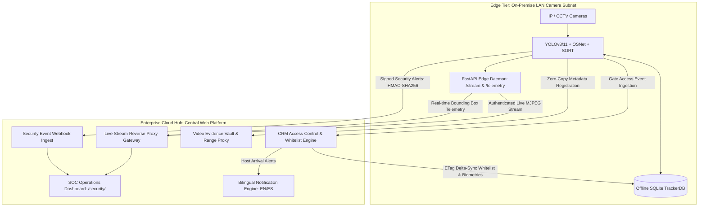

# Enterprise Hub & Intelligent Tracker Integration Guide
## Connecting Edge AI Vision Nodes (`intelligent-tracker`) to the Enterprise Cloud Hub (`enterprise-website`)

---

### 1. Executive Architecture & System Topology

The **Enterprise Website** functions as the central **Security Operations Center (SOC) Cloud Hub** for distributed, on-premise **Intelligent Tracker** edge nodes. This architecture separates high-frequency, GPU/NPU-accelerated video inference on edge nodes from central identity governance, multi-site video archiving, compliance holds, and bilingual communication on the Hub.



---

### 2. Hub-Side Configuration & Security Architecture

#### A. Shared Cryptographic Secret (HMAC-SHA256)
All edge-to-hub communications that alter security state (`POST /api/v1/security/events/`, `POST /api/v1/security/access/`, and `GET /api/v1/security/whitelist/`) are authenticated using **HMAC-SHA256** signatures via the `X-Tracker-Signature` HTTP header.

Configure the shared secret in the Hub's `.env` configuration:
```env
# Shared secret for Edge AI Vision Node verification
TRACKER_SHARED_SECRET="replace-with-a-cryptographically-secure-random-token"
```

The Hub uses constant-time comparison (`hmac.compare_digest`) to prevent timing side-channel attacks.

#### B. Location & Camera Scaffolding
Every camera connected to an edge node is mapped hierarchically under a physical site:
1. **Physical Site:** Registered in `location_management.models.Location`.
2. **Camera Entity:** Registered in `intelligent_tracker_hub.models.Camera`:
   - `camera_id`: Unique slug identifier (e.g., `cam-north-gate-01`).
   - `site`: Foreign Key to `Location`.
   - `stream_url`: Edge MJPEG endpoint (e.g., `http://192.168.1.100:8000/stream/cam_01`).
   - `status`: Dynamic state (`ONLINE`, `OFFLINE`, `CONNECTING`, `DEGRADED`).
   - `fps` & `resolution`: Current stream parameters.

---

### 3. Hub REST API Surface Specification

#### A. Security Webhook Ingestion
- **Endpoint:** `POST /api/v1/security/events/`
- **Authentication:** `X-Tracker-Signature` header calculated as:
  $$\text{HMAC-SHA256}(\text{TRACKER\_SHARED\_SECRET}, \text{raw\_json\_body})$$
- **Payload Schema:**
  ```json
  {
    "event_id": "c73a812b-31d7-46f0-9a22-9bc5ef9f3a12",
    "event_type": "IntrusionAlert",
    "site_id": 1,
    "camera_id": "cam-north-gate-01",
    "timestamp": "2026-10-28T21:00:00Z",
    "timestamp_epoch": 1793221200.0,
    "snapshot_base64": "/9j/4AAQSkZJRg...",
    "metadata": {
      "zone_name": "Perimeter North",
      "dwell_seconds": 14.5,
      "confidence": 0.94,
      "entity_id": "track_42"
    }
  }
  ```
- **Supported Event Types:** `IntrusionAlert`, `RestrictedEntityAlert`, `OccupancyThresholdEvent`, `FallDetectedAlert`, `LoiteringAlert`, `LineCrossAlert`.
- **Hub Processing:** Creates a `SecurityEvent` record, stores evidence thumbnails, logs an immutable entry in `SecurityAuditLog`, and broadcasts real-time alerts to active SOC operators.

#### B. CRM Whitelist Delta-Sync API
- **Endpoint:** `GET /api/v1/security/whitelist/?site_id={site_id}`
- **Authentication:** `X-Tracker-Signature` header or session authentication.
- **Delta-Sync Caching Protocol:**
  - **ETag Validation:** The edge node supplies `If-None-Match: "<last_etag>"`. If the active site credentials have not changed, the Hub immediately responds with **`HTTP 304 Not Modified`** (0 payload bytes), eliminating WAN bandwidth overhead.
  - **Incremental Sync:** The edge node can optionally supply `?since=<iso-timestamp>` to fetch only credentials created or modified after that timestamp.
- **Payload Schema:**
  ```json
  {
    "site_id": 1,
    "version_etag": "W/\"d41d8cd98f00b204e9800998ecf8427e\"",
    "timestamp": "2026-10-28T21:00:00Z",
    "total_count": 42,
    "whitelist": [
      {
        "id": 105,
        "first_name": "Alice",
        "last_name": "Smith",
        "full_name": "Alice Smith",
        "security_clearance": "STAFF",
        "security_tag": "Engineering",
        "license_plate": "ABC1234",
        "face_embedding_vector": [0.045, -0.112, 0.089, ...],
        "valid_from": "2026-01-01T08:00:00Z",
        "valid_until": "2026-12-31T18:00:00Z",
        "is_active": true
      }
    ]
  }
  ```
- **Security Pruning:** Expired temporary visitor passes are automatically omitted. Banned or watchlisted entities are flagged with `"security_clearance": "BANNED"`, arming the edge node to intercept unauthorized entries.

#### C. Gate Access Event Ingestion
- **Endpoint:** `POST /api/v1/security/access/`
- **Authentication:** `X-Tracker-Signature` header.
- **Payload Schema:**
  ```json
  {
    "event_uuid": "evt-gate-001",
    "site_id": 1,
    "camera_id": "cam-gate-01",
    "contact_id": 105,
    "direction": "IN",
    "verification_method": "FACE",
    "confidence": 0.92,
    "access_decision": "GRANTED",
    "denial_reason": "",
    "timestamp": "2026-10-28T21:05:00Z",
    "license_plate_captured": "ABC1234",
    "snapshot_base64": "/9j/4AAQSkZJRg..."
  }
  ```
- **Hub Processing:**
  1. Records the access event in `VisitorAccessLog`.
  2. Updates `crm.Contact.presence_status` to `"on_premises"` (or `"off_premises"` on exit) with `last_seen_at` and `last_seen_location`.
  3. Records a `SECURITY_ACCESS` touchpoint in `crm.InteractionLog`.
  4. Dispatches bilingual host arrival notifications (EN/ES) via `intelligent_tracker_hub.notifications.send_visitor_arrival_notification`.
  5. Automatically escalates unauthorized or banned intrusion attempts to `SecurityEvent` (`RESTRICTED_ENTITY`, `CRITICAL`).

#### D. Live Stream Reverse Proxy Gateway
- **Endpoint:** `GET /api/v1/security/stream/live/<camera_id>/`
- **Purpose:** Solves the **NAT/WAN traversal barrier**. Browser clients cannot reach private camera IP addresses (`192.168.x.x`). The Hub acts as an authenticated reverse proxy, multiplexing a single edge stream to authorized operators.
- **Format:** `multipart/x-mixed-replace; boundary=frame` (MJPEG).
- **Graceful Fallback:** If the edge camera is offline, unreachable, or configured with `mock://`, the Hub automatically activates an internal synthetic surveillance stream generator with live timestamps and simulated tracking bounding boxes.

#### E. Video Evidence Ingestion & Zero-Copy Proxy Gateway (`video_gallery`)
- **Zero-Copy Registration:** `POST /api/v1/gallery/register/`
  - Edge nodes register video clips by reference URL without duplicating heavy MP4 bytes onto the Hub disk.
  - Links ground-plane homography trajectories directly to the incident record.
- **On-Demand Range Proxy:** `GET /api/v1/gallery/stream/<video_id>/`
  - Proxies streaming requests with **HTTP 206 Partial Content** / Range request headers directly to browser clients for instant scrubbing and playback.
- **Compliance Archival Hold:** `POST /api/v1/gallery/archive/<video_id>/`
  - Pulls the remote MP4 into central storage for permanent legal holds, with SHA-256 integrity checksum verification and `?force=true` self-healing repair.

---

### 4. Edge Node (`intelligent-tracker`) Configuration Reference

Edge nodes connect to this Hub by providing the Hub's base URL and shared secret.

#### Sample Edge Configuration (`configs/hub_connection.yaml` or `.env`)
```yaml
enterprise_hub:
  enabled: true
  base_url: "https://hub.example.com"
  site_id: 1
  secret_key: "replace-with-a-cryptographically-secure-random-token"
  sync_interval_seconds: 300
  heartbeat_interval_seconds: 15
```

#### Sample Outbound Webhook Dispatch (Python on Edge)
```python
import hmac
import hashlib
import json
import urllib.request
from datetime import datetime, timezone

def dispatch_security_alert(hub_url, site_id, camera_id, secret_key, event_type, metadata, snapshot_b64=None):
    payload = {
        "event_id": str(uuid.uuid4()),
        "event_type": event_type,
        "site_id": site_id,
        "camera_id": camera_id,
        "timestamp": datetime.now(timezone.utc).strftime("%Y-%m-%dT%H:%M:%SZ"),
        "timestamp_epoch": time.time(),
        "snapshot_base64": snapshot_b64,
        "metadata": metadata,
    }
    json_bytes = json.dumps(payload).encode("utf-8")
    signature = hmac.new(secret_key.encode("utf-8"), json_bytes, hashlib.sha256).hexdigest()

    req = urllib.request.Request(
        f"{hub_url}/api/v1/security/events/",
        data=json_bytes,
        headers={
            "Content-Type": "application/json",
            "X-Tracker-Signature": signature,
            "User-Agent": "IntelligentTracker-Edge/1.0",
        },
        method="POST"
    )
    with urllib.request.urlopen(req, timeout=5) as response:
        return response.status == 201
```

#### Sample Whitelist Delta-Sync Poller (Python on Edge)
```python
import hmac
import hashlib
import urllib.request
import json

def fetch_whitelist_delta(hub_url, site_id, secret_key, last_etag=None):
    url = f"{hub_url}/api/v1/security/whitelist/?site_id={site_id}"
    req = urllib.request.Request(url, method="GET")
    
    # Calculate HMAC signature for GET request
    sig = hmac.new(secret_key.encode("utf-8"), f"GET:{site_id}".encode("utf-8"), hashlib.sha256).hexdigest()
    req.add_header("X-Tracker-Signature", sig)
    
    if last_etag:
        req.add_header("If-None-Match", last_etag)

    try:
        with urllib.request.urlopen(req, timeout=10) as resp:
            new_etag = resp.headers.get("ETag")
            data = json.loads(resp.read().decode("utf-8"))
            return new_etag, data.get("whitelist", [])
    except urllib.error.HTTPError as e:
        if e.code == 304:
            # Whitelist unchanged; 0 bytes transferred
            return last_etag, None
        raise
```

---

### 5. Offline Autonomous Resilience (`TrackerDB`)

During WAN disconnects or cloud infrastructure maintenance, the edge node continues autonomous security operations:

```
[Camera Recognition] 
         │
         ▼
[Check Local SQLite Cache: local_whitelist]
   ├─► IF Valid: Open Gate ──► [Record in offline_access_queue (synced=0)]
   └─► IF Unknown/Banned: Deny ──► [Record in offline_access_queue (synced=0)]
                                                   │
   [WAN Connection Restored] ◄─────────────────────┘
         │
         ▼
[POST /api/v1/security/access/ in Batches] ──► [Mark synced=1]
```

Full database DDL, schema definitions, and index designs are specified in:
[**`INTELLIGENT_TRACKER_OFFLINE_DB_SPEC.md`**](INTELLIGENT_TRACKER_OFFLINE_DB_SPEC.md).

---

### 6. Verification & Scenario Matrix

| Scenario / Objective | Mode / Inputs | Target Protocol / Endpoint | Verification Command |
| :--- | :--- | :--- | :--- |
| **System Diagnostics** | Django System Check | Core Settings & Models | `python manage.py check` |
| **Security Webhook Ingestion** | HMAC Signed Payload | `POST /api/v1/security/events/` | `pytest tests/test_intelligent_tracker_hub.py -k test_security_event_webhook` |
| **Whitelist ETag Caching** | ETag & 304 Validation | `GET /api/v1/security/whitelist/` | `pytest tests/test_intelligent_tracker_hub.py -k test_whitelist_delta_sync` |
| **Live Stream Reverse Proxy** | MJPEG Stream Ingestion | `GET /api/v1/security/stream/live/<id>/` | `pytest tests/test_intelligent_tracker_hub.py -k test_live_stream_proxy` |
| **Zero-Copy Video Stream** | HTTP 206 Range Proxy | `GET /api/v1/gallery/stream/<id>/` | `pytest tests/test_intelligent_tracker_hub.py -k test_video_stream_gateway` |
| **Full Security Hub Suite** | Complete Test Suite | All Hub API Views & Models | `pytest tests/test_intelligent_tracker_hub.py -v` |
| **Full Repository Test Suite** | 271 Tests | Repository-wide Verification | `pytest tests/ -v` |

