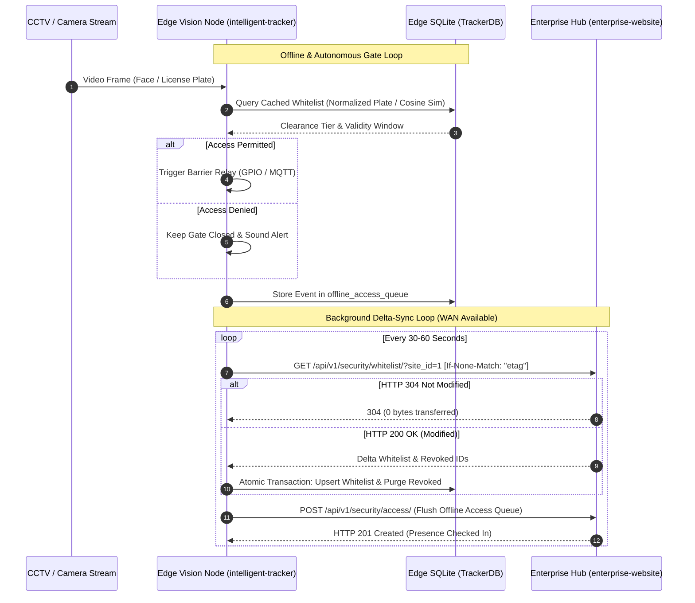

# Offline-First Edge Cache (TrackerDB) Specification
## davtoh/intelligent-tracker Local SQLite Synchronization Protocol

---

### 1. Executive Architecture

When deployed at physical gates, checkpoints, and turnstiles, edge vision inference nodes (`davtoh/intelligent-tracker`) must guarantee uninterrupted real-time operation even during WAN drops, fiber cuts, or central server maintenance.



---

### 2. Local SQLite Schema DDL (`TrackerDB`)

The edge daemon maintains an embedded SQLite database at `data/tracker_db.sqlite3`:

```sql
-- Edge Daemon Metadata & Sync Checkpoints
CREATE TABLE IF NOT EXISTS tracker_sync_state (
    site_id INTEGER PRIMARY KEY,
    site_code TEXT NOT NULL,
    last_etag TEXT,
    last_sync_timestamp TEXT,
    active_whitelist_count INTEGER DEFAULT 0
);

-- Local Mirror of Authoritative CRM Credentials
CREATE TABLE IF NOT EXISTS local_whitelist (
    contact_id INTEGER PRIMARY KEY,
    full_name TEXT NOT NULL,
    security_clearance TEXT NOT NULL,
    security_tag TEXT,
    license_plate TEXT,
    license_plate_norm TEXT,
    valid_from INTEGER,           -- UTC Unix Epoch (seconds)
    valid_until INTEGER,          -- UTC Unix Epoch (seconds)
    is_banned INTEGER DEFAULT 0,  -- 1 if clearance == 'BANNED'
    face_embedding_blob BLOB,     -- Pre-computed 512-d float32 array
    updated_at TEXT NOT NULL
);

CREATE INDEX IF NOT EXISTS idx_whitelist_plate ON local_whitelist(license_plate_norm);
CREATE INDEX IF NOT EXISTS idx_whitelist_tag ON local_whitelist(security_tag);
CREATE INDEX IF NOT EXISTS idx_whitelist_validity ON local_whitelist(valid_from, valid_until, is_banned);

-- Outbox Queue for Disconnected Access Events
CREATE TABLE IF NOT EXISTS offline_access_queue (
    queue_id TEXT PRIMARY KEY,    -- UUID string
    contact_id INTEGER,
    site_id INTEGER NOT NULL,
    camera_id TEXT NOT NULL,
    direction TEXT NOT NULL,      -- 'ENTRY' or 'EXIT'
    verification_method TEXT NOT NULL, -- 'face', 'plate', 'tag', 'manual'
    recognized_identifier TEXT,
    confidence REAL,
    access_granted INTEGER NOT NULL,
    denial_reason TEXT,
    timestamp TEXT NOT NULL,      -- ISO-8601 UTC
    snapshot_base64 TEXT,
    metadata_json TEXT,
    sync_status TEXT DEFAULT 'PENDING', -- 'PENDING', 'SYNCED', 'FAILED'
    retry_count INTEGER DEFAULT 0,
    created_at TEXT DEFAULT CURRENT_TIMESTAMP
);

CREATE INDEX IF NOT EXISTS idx_queue_pending ON offline_access_queue(sync_status);
```

---

### 3. Edge Synchronization Protocol & Logic

#### Step 1: Whitelist Delta-Sync Query
The edge service periodically calls the Hub's delta-sync API:
```http
GET /api/v1/security/whitelist/?site_id=1 HTTP/1.1
Host: hub.enterprise.local
If-None-Match: "a3b98f12c8..."
X-Tracker-Signature: <hmac-sha256-signature>
```

#### Step 2: ETag Handling
1. If the Hub returns **`HTTP 304 Not Modified`**:
   - Zero database writes and zero deserialization required.
   - Network payload is 0 bytes.
2. If the Hub returns **`HTTP 200 OK`**:
   - Extracts `whitelist`, `revoked_ids`, `version_hash`, and `server_time`.
   - Executes an atomic SQLite transaction:
     ```sql
     BEGIN TRANSACTION;
     -- 1. Purge explicitly revoked or expired IDs
     DELETE FROM local_whitelist WHERE contact_id IN (?, ?, ...);

     -- 2. Upsert active credentials
     INSERT INTO local_whitelist (
         contact_id, full_name, security_clearance, security_tag,
         license_plate, license_plate_norm, valid_from, valid_until,
         is_banned, face_embedding_blob, updated_at
     ) VALUES (?, ?, ?, ?, ?, ?, ?, ?, ?, ?, ?)
     ON CONFLICT(contact_id) DO UPDATE SET
         full_name=excluded.full_name,
         security_clearance=excluded.security_clearance,
         security_tag=excluded.security_tag,
         license_plate=excluded.license_plate,
         license_plate_norm=excluded.license_plate_norm,
         valid_from=excluded.valid_from,
         valid_until=excluded.valid_until,
         is_banned=excluded.is_banned,
         face_embedding_blob=excluded.face_embedding_blob,
         updated_at=excluded.updated_at;

     -- 3. Update sync state checkpoint
     UPDATE tracker_sync_state
     SET last_etag = ?, last_sync_timestamp = ?, active_whitelist_count = (SELECT COUNT(*) FROM local_whitelist);
     COMMIT;
     ```

#### Step 3: Local Offline Authorization Decision
When a vehicle or face is detected at the gate:
```python
def authorize_offline(plate_str=None, face_embedding=None, tag_str=None):
    now_ts = int(time.time())
    
    # 1. License Plate Match (ANPR)
    if plate_str:
        norm_plate = re.sub(r"[^A-Z0-9]", "", plate_str.upper())
        record = db.query("SELECT * FROM local_whitelist WHERE license_plate_norm = ?", [norm_plate])
        if record:
            return evaluate_clearance(record, now_ts)
            
    # 2. Facial Embedding Cosine Similarity (OSNet / ArcFace)
    if face_embedding is not None:
        best_match, max_sim = db.find_best_cosine_match(face_embedding, threshold=0.68)
        if best_match:
            return evaluate_clearance(best_match, now_ts)
            
    return {"access_granted": False, "denial_reason": "Unrecognized"}

def evaluate_clearance(contact, now_ts):
    if contact["is_banned"]:
        return {"access_granted": False, "denial_reason": "Banned Entity", "contact": contact}
    if contact["valid_from"] and now_ts < contact["valid_from"]:
        return {"access_granted": False, "denial_reason": "Pass Not Yet Active", "contact": contact}
    if contact["valid_until"] and now_ts > contact["valid_until"]:
        return {"access_granted": False, "denial_reason": "Pass Expired", "contact": contact}
    return {"access_granted": True, "denial_reason": "", "contact": contact}
```

#### Step 4: Outbox Flush
Whenever WAN connectivity is restored, the edge node flushes rows where `sync_status = 'PENDING'` via `POST /api/v1/security/access/`. Once the Hub returns `HTTP 201 Created`, the row is marked `'SYNCED'` or purged.

---

### 4. Summary & Verification Matrix

| Component | Offline Behavior | Hub Connected Behavior |
|---|---|---|
| **Gate Latency** | < 15ms (local SQLite lookup) | < 15ms (local lookup first) |
| **Pass Invalidation** | Immediate if pre-cached; evaluated by `valid_until_ts` | Instantaneous via ETag delta push |
| **WAN Resilience** | 100% autonomous operation | Bi-directional presence sync |
| **Audit Continuity** | Buffered in `offline_access_queue` | Transferred to central `VisitorAccessLog` |
