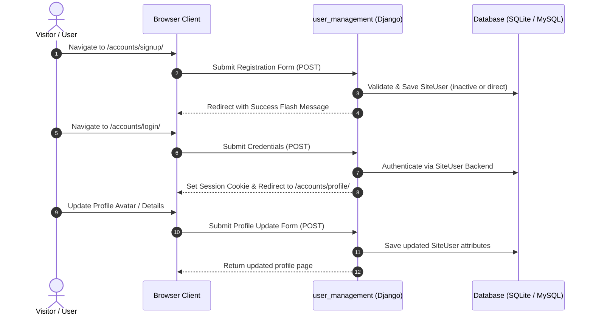
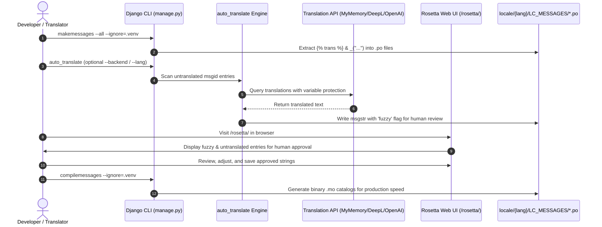
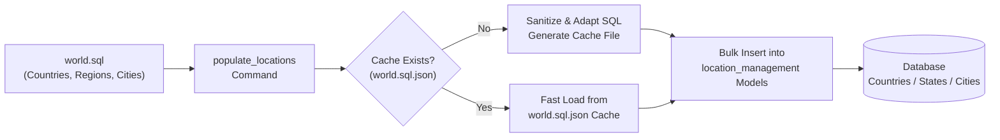
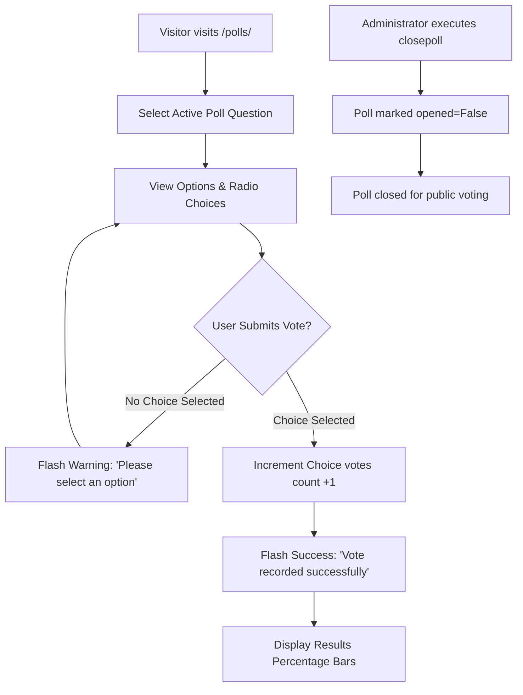

# Enterprise Website — Architecture & Operations Manual

A comprehensive guide to the architecture, purpose, functionalities, system flows, and maintenance operations of the Enterprise Website platform.

---

## Table of Contents
1. [Executive Summary & Purpose](#1-executive-summary--purpose)
2. [Project Architecture & Directory Structure](#2-project-architecture--directory-structure)
3. [Core Modules & Functionalities](#3-core-modules--functionalities)
4. [System Workflows](#4-system-workflows)
   - [Authentication & User Lifecycle](#authentication--user-lifecycle)
   - [Internationalization & Rosetta Translation Pipeline](#internationalization--rosetta-translation-pipeline)
   - [Location & Geo-Data Processing](#location--geo-data-processing)
   - [Polls & Interactive Voting](#polls--interactive-voting)
5. [Maintenance & Management Commands Guide](#5-maintenance--management-commands-guide)
   - [Virtual Environment & Execution Standards](#virtual-environment--execution-standards)
   - [Database Migrations & Setup](#database-migrations--setup)
   - [User Management & Testing Fixtures](#user-management--testing-fixtures)
   - [Data Population & Pre-Loaded Databases](#data-population--pre-loaded-databases)
   - [Translation & i18n Tooling (Rosetta & Auto-Translate)](#translation--i18n-tooling-rosetta--auto-translate)
   - [Server Execution (Development & Production ASGI)](#server-execution-development--production-asgi)
6. [Security & Production Readiness](#6-security--production-readiness)

---

## 1. Executive Summary & Purpose

The **Enterprise Website** is a modular web portal engineered with **Django 5.0**, **Channels / Daphne** (WebSockets/ASGI), **Django REST Framework**, and **django-allauth**.

### Purpose
The platform provides a solid foundation for industrial, commercial, and enterprise businesses to:
- **Showcase Products and Services:** Present corporate offerings, company history, portfolio items, and direct inquiry channels.
- **Engage Users & Clients:** Offer personalized self-service portals, task management, dynamic polls, and client profile management.
- **Support International Audiences:** Provide multi-language translation and localization across 5 target locales (`es`, `fr`, `it`, `ja`, `pt`) using GNU gettext and Django Rosetta.
- **Enable API-Driven Extensibility:** Expose modern REST APIs for mobile applications, third-party services, and microservices.
- **Ensure Multi-Platform Agility:** Run on Linux, macOS, and Windows with zero platform-specific hardcoding.

---

## 2. Project Architecture & Directory Structure

The repository follows a clean, decoupled Django modular application architecture:

```
enterprise_website/
│
├── enterprise_website/           # Core Project Orchestrator
│   ├── settings.py               # 12-factor settings (loads .env, dynamic DB, i18n, Rosetta)
│   ├── urls.py                   # Root URLconf with namespace routing
│   ├── asgi.py                   # ASGI entrypoint for Daphne (HTTP + WebSockets)
│   ├── wsgi.py                   # WSGI entrypoint for traditional HTTP servers
│   └── routing.py                # Channels WebSocket protocol router
│
├── home/                         # Corporate Web Showcase
│   ├── views.py                  # Class-Based Views (Home, About, Services, Products, Contact)
│   ├── forms.py                  # Contact inquiry validation
│   ├── urls.py                   # SEO-friendly paths with legacy aliases
│   └── templates/home/           # Showcase page templates (index, about, services, products, contact)
│
├── user_management/              # Custom Authentication & Profile Management
│   ├── models.py                 # Custom SiteUser model (phone validation, avatars, birthdate)
│   ├── forms.py                  # Signup, login, profile edit, avatar upload forms
│   ├── views.py                  # Profile view, image upload, activation, password reset
│   └── management/commands/      # populate_users command for testing fixtures
│
├── todo/                         # Interactive Task Management App
│   ├── models.py                 # Task/Todo items linked to authenticated users
│   ├── views.py                  # CRUD operations (add, complete, details, delete)
│   └── templates/todo/           # Responsive task cards and list templates
│
├── polls/                        # Interactive Voting & Polling App
│   ├── models.py                 # Question and Choice models with vote counters
│   ├── views.py                  # Question listing, voting submission, results visualization
│   └── management/commands/      # closepoll command for administrative moderation
│
├── language_management/          # Internationalization & Automated Localization
│   ├── views.py                  # Dynamic language switcher view
│   └── management/commands/      # auto_translate pipeline (MyMemory, DeepL, OpenAI)
│
├── location_management/          # Geographical & Regional Models
│   ├── models.py                 # Countries, States, Cities models
│   └── management/commands/      # populate_locations data-loading pipeline
│
├── timezone_management/          # ZoneInfo-Powered Timezone Detection
│   ├── views.py                  # Session-based timezone switcher
│   └── middleware.py             # Automatic user timezone activation
│
├── rest_api/                     # Django REST Framework Endpoints
│   ├── serializers.py            # Serializers for SiteUser, Todo, Polls, Locations
│   └── views.py                  # ModelViewSets and API documentation views
│
├── webprogram/                   # Brython Python-in-Browser Playground
│   └── views.py                  # Client-side Python execution demonstrations
│
├── custom_tags/                  # Shared Utilities & Base Commands
│   ├── utils.py                  # LoggerCommand, source file loaders, key generators
│   └── management/commands/      # secret_keys utility command
│
├── templates/                    # Global Base Templates & Component Partials
│   ├── base.html                 # Master HTML5 layout (navbar, footer, flash messages)
│   ├── partials/messages.html    # Django messages alert component
│   └── admin/base_site.html      # Customized Django Admin banner
│
├── static/                       # Static Assets
│   ├── css/                      # Stylesheets (custom + responsive design)
│   ├── js/                       # Interactive JavaScript scripts
│   └── images/                   # Corporate branding and demo assets
│
├── locale/                       # Gettext Translation Catalogs
│   ├── es/LC_MESSAGES/           # Spanish translation catalog (.po & .mo)
│   ├── fr/LC_MESSAGES/           # French translation catalog (.po & .mo)
│   ├── it/LC_MESSAGES/           # Italian translation catalog (.po & .mo)
│   ├── ja/LC_MESSAGES/           # Japanese translation catalog (.po & .mo)
│   └── pt/LC_MESSAGES/           # Portuguese translation catalog (.po & .mo)
│
├── documentation/                # Complete Architectural & Modeling Documentation
│   ├── README.md                 # This system operations manual
│   └── web_page_general_models.mdj # StarUML architectural models
│
├── requirements/                 # Modular Dependency Specifications
│   ├── base.txt                  # Core runtime dependencies (Django 5.0, DRF, Allauth)
│   ├── local.txt                 # Development tools (pytest, debuggers)
│   └── production.txt            # Production servers (Daphne, mysqlclient, psycopg2)
│
├── .env.example                  # Environment configuration template
├── manage.py                     # Django management CLI wrapper
├── AGENTS.md                     # Modernization guidelines & AI rules
└── MIGRATION_LOG.md              # Historical migration and milestone audit trail
```

---

## 3. Core Modules & Functionalities

### 3.1 Corporate Showcase (`home`)
- **Pages:** Home (`/`), About Us (`/about.html` & `/about/`), Services (`/services.html` & `/services/`), Products (`/products.html` & `/products/`), and Contact (`/contact.html` & `/contact/`).
- **Inquiry Processing:** Validates customer feedback and inquiries with CSRF protection and provides multi-language feedback flash alerts via `messages.success`.
- **Legacy Path Compatibility:** Dual-routing support keeps legacy `.html` links functional alongside canonical clean URLs.

### 3.2 Authentication & User Management (`user_management`)
- **Custom User Model:** `user_management.SiteUser` extends `AbstractUser` with birthdate, avatar upload, and international phone number validation via `phonenumber_field`.
- **Social Login:** Built-in `django-allauth` integration supports Google OAuth2 credentials.
- **Account Security:** Strict CSRF tokens, safe password hashing, base64 activation link tokens, and Django 5 compatible Logout views.
- **Profile Center:** User dashboard allowing avatar photo uploads, profile detail updates, and password changes.

### 3.3 Interactive Applications (`todo`, `polls`, `webprogram`)
- **Todo System:** Task management with target due dates, completion states, and user isolation.
- **Polls Engine:** Multi-option voting system with fraud prevention (one vote per question per session/user) and real-time result percentage bars.
- **Brython Playground:** Demonstrates running native Python 3 code directly in the client's browser DOM without backend server roundtrips.

### 3.4 REST API (`rest_api`)
- Built on **Django REST Framework (DRF)**.
- Provides serialized JSON endpoints for user profiles, tasks, questions, and choices.
- Interactive browsable API available at `/rest_api/`.

### 3.5 Localization & Translation (`language_management`)
- Full gettext i18n support across all templates and Python code.
- Dynamic session and cookie language switching (`/languages/set_language/`).
- Web-based translation portal powered by `django-rosetta` at `/rosetta/`.
- Automated translation baseline generator via `python manage.py auto_translate`.

---

## 4. System Workflows

### Authentication & User Lifecycle


---

### Internationalization & Rosetta Translation Pipeline


---

### Location & Geo-Data Processing


---

### Polls & Interactive Voting


---

## 5. Maintenance & Management Commands Guide

### Virtual Environment & Execution Standards
In accordance with repository guidelines, **always use the project virtual environment** to ensure dependencies resolve correctly:

- **Windows (PowerShell):**
  ```powershell
  .\.venv\Scripts\python.exe manage.py <command>
  ```
- **Linux / macOS (Bash / Zsh):**
  ```bash
  source .venv/bin/activate
  python manage.py <command>
  ```

---

### Database Migrations & Setup

1. **Check System Health:**
   ```powershell
   .\.venv\Scripts\python.exe manage.py check
   ```

2. **Generate New Migration Files:**
   ```powershell
   .\.venv\Scripts\python.exe manage.py makemigrations
   ```

3. **Apply Database Migrations:**
   ```powershell
   .\.venv\Scripts\python.exe manage.py migrate
   ```

4. **Inspect Migration Status:**
   ```powershell
   .\.venv\Scripts\python.exe manage.py showmigrations
   ```

---

### User Management & Testing Fixtures

1. **Create Administrator Superuser:**
   Creates an administrative superuser account with full access to `/admin/`:
   ```powershell
   .\.venv\Scripts\python.exe manage.py createsuperuser --username=admin --email=admin@example.com
   ```

2. **Populate Debug Test Users (`populate_users`):**
   Generates standard testing user personas (`superuser`, `staff`, `regular`) with passwords identical to their usernames.
   ```powershell
   .\.venv\Scripts\python.exe manage.py populate_users --test
   ```
   > [!WARNING]
   > Do **NOT** use `--test` in production! This creates publicly predictable credentials. Use only for local development and integration tests.

   Custom user generation:
   ```powershell
   # Create a custom staff user
   .\.venv\Scripts\python.exe manage.py populate_users --staff operator1
   # Update passwords if user already exists
   .\.venv\Scripts\python.exe manage.py populate_users --test --update
   ```

---

### Data Population & Pre-Loaded Databases

1. **Populate Countries, States, and Cities (`populate_locations`):**
   Imports global geographical datasets into `location_management` models:
   ```powershell
   .\.venv\Scripts\python.exe manage.py populate_locations
   ```
   > [!NOTE]
   > The first run sanitizes `world.sql` and generates a local cached `world.sql.json` file. Subsequent runs execute quickly using the cache.

2. **Close or Moderate Polls (`closepoll`):**
   ```powershell
   # Close poll ID 1 from voting
   .\.venv\Scripts\python.exe manage.py closepoll 1
   # Delete poll ID 2 completely
   .\.venv\Scripts\python.exe manage.py closepoll 2 --delete
   ```

---

### Translation & i18n Tooling (Rosetta & Auto-Translate)

The project supports 5 languages: **Spanish (`es`)**, **French (`fr`)**, **Italian (`it`)**, **Japanese (`ja`)**, and **Portuguese (`pt`)**.

1. **Extract Translatable Strings from Code and Templates:**
   Scans all Python files and HTML templates, updating catalog `.po` files:
   ```powershell
   .\.venv\Scripts\python.exe manage.py makemessages --all --ignore=.venv
   ```
   *Single language extraction:*
   ```powershell
   .\.venv\Scripts\python.exe manage.py makemessages -l es --ignore=.venv
   ```

   > [!TIP]
   > If Windows throws `Can't find msguniq... make sure GNU gettext tools are installed`:
   > Download and install the precompiled gettext binary for Windows from [mlocati gettext-iconv-windows](https://mlocati.github.io/articles/gettext-iconv-windows.html) and add its `bin/` directory to your system `PATH`.

2. **Automated Machine Translation Baseline (`auto_translate`):**
   Translates untranslated strings automatically while shielding variables (e.g., `%(name)s`, `{{ value }}`).

   ```powershell
   # 1. Translate all untranslated strings across all configured languages (free MyMemory backend)
   .\.venv\Scripts\python.exe manage.py auto_translate

   # 2. Translate a specific language only (e.g. Spanish)
   .\.venv\Scripts\python.exe manage.py auto_translate --lang es

   # 3. Use DeepL translation (requires DEEPL_AUTH_KEY in .env)
   .\.venv\Scripts\python.exe manage.py auto_translate --backend deepl

   # 4. Use OpenAI translation (requires OPENAI_API_KEY in .env)
   .\.venv\Scripts\python.exe manage.py auto_translate --backend openai

   # 5. Mark as final immediately without the 'fuzzy' flag (bypasses Rosetta review queue)
   .\.venv\Scripts\python.exe manage.py auto_translate --no-fuzzy

   # 6. Test with a batch limit (e.g., translate only 10 strings per language)
   .\.venv\Scripts\python.exe manage.py auto_translate --max 10
   ```

3. **Human Review via Rosetta Web Portal:**
   Start the server and visit `http://127.0.0.1:8000/rosetta/` with an active staff or superuser account to review, edit, and approve translations.

4. **Compile Message Catalogs (.po -> .mo):**
   Compiles human-readable `.po` catalogs into binary `.mo` files for fast production lookup:
   ```powershell
   .\.venv\Scripts\python.exe manage.py compilemessages --ignore=.venv
   ```

---

### Server Execution (Development & Production ASGI)

1. **Local Development Server (HTTP):**
   ```powershell
   .\.venv\Scripts\python.exe manage.py runserver 127.0.0.1:8000
   ```
   - Main Site: `http://127.0.0.1:8000/`
   - Admin Panel: `http://127.0.0.1:8000/admin/`
   - REST API: `http://127.0.0.1:8000/rest_api/`
   - Rosetta Translations: `http://127.0.0.1:8000/rosetta/`

2. **Production ASGI Server (Daphne):**
   For production with async HTTP & WebSockets support:
   ```bash
   daphne -b 0.0.0.0 -p 8000 enterprise_website.asgi:application
   ```

---

## 6. Security & Production Readiness

### Environment Secrets Management
- All credentials are isolated in `.env` using `python-dotenv`.
- Raw secret keys, database passwords, and API credentials must **never** be committed to version control.
- An annotated `.env.example` file is provided in the repository root.

### Production Database Setup (MySQL / PostgreSQL)
When switching from the default zero-setup SQLite engine to MySQL or PostgreSQL:

1. **MySQL Installation & Database Creation (Ubuntu/Debian):**
   ```bash
   sudo apt update
   sudo apt install mysql-server libmysqlclient-dev
   sudo mysql_secure_installation
   ```
   Create database and dedicated user:
   ```sql
   CREATE DATABASE productsDB CHARACTER SET utf8mb4 COLLATE utf8mb4_unicode_ci;
   CREATE USER 'enterprise_user'@'localhost' IDENTIFIED BY 'StrongPasswordHere123!';
   GRANT ALL PRIVILEGES ON productsDB.* TO 'enterprise_user'@'localhost' WITH GRANT OPTION;
   FLUSH PRIVILEGES;
   ```

2. **Update `.env`:**
   ```ini
   USE_SQLITE=False
   DB_ENGINE=django.db.backends.mysql
   DB_NAME=productsDB
   DB_USER=enterprise_user
   DB_PASSWORD=StrongPasswordHere123!
   DB_HOST=127.0.0.1
   DB_PORT=3306
   ```

3. **Install Production Requirements & Migrate:**
   ```bash
   pip install -r requirements/production.txt
   python manage.py migrate
   ```
